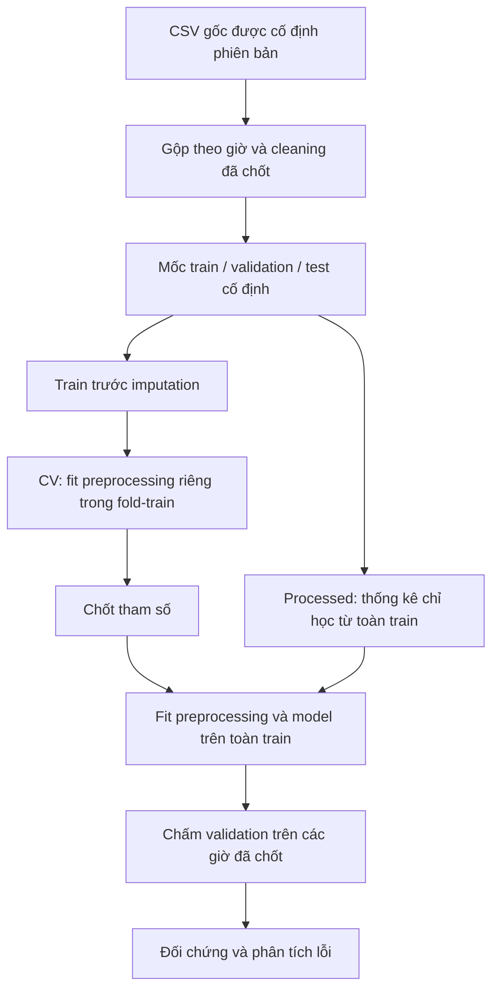

# Hướng dẫn đối chứng thí nghiệm và chọn nguồn dữ liệu

Ngày kiểm tra: 19/11/2026. Áp dụng cho [32 dòng danh mục thí nghiệm](EXPERIMENTS_BY_DATE_AND_RQ.md). Tài liệu này hướng dẫn đối chứng và cách đọc dữ liệu chung; chưa chạy lại mô hình hoặc chấm test.

**Cập nhật triển khai 19/11/2026:** 25 notebook đọc dữ liệu đã chuyển sang [load_experiment_splits](../../src/experiment_data.py); notebook tổng kết chỉ đọc hiện vật nên không cần loader. Đã sửa code lấy dữ liệu, chưa chạy lại mô hình hoặc chấm test. Các output cũ vẫn giữ nguyên và được gắn nhãn lịch sử trong notebook.

## 1. Có nên lấy từ data/processed/ không?

**Có, dùng `data/processed/train.csv` và `validation.csv` làm bản dữ liệu bàn giao cố định cho các đối chứng không thay tiền xử lý. Tuy nhiên, chúng không thay được dữ liệu trước imputation/encoding khi cần CV nghiêm ngặt hoặc nghiên cứu chính cách tiền xử lý.** Đường dẫn hiện tại là `data/processed/`, không phải `data/process/`.

| Việc cần làm | Nguồn phù hợp | Điều kiện |
|---|---|---|
| Đọc/kiểm tra lại kết quả lịch sử | Predictions + params + cấu hình và phiên bản dữ liệu của chính run cũ | Không tái tạo run cũ bằng CSV hiện tại rồi mặc định coi hai phiên bản giống nhau. Hash và timestamp phải khớp. |
| So feature hoặc mô hình trên một train/validation cố định, không đổi cleaning | `data/processed/train.csv`, `validation.csv` | Dùng cùng snapshot, cùng giờ, cùng preprocessing theo thiết kế. Fit scaler/target scaler của mô hình trên train. |
| Tuning bằng CV trên train | Bảng theo giờ **trước điền thiếu**, dựng từ raw qua `load_hourly_splits(...)`, hoặc cache tương đương có phiên bản | Mỗi fold tự học imputer, scaler và danh mục encoder từ fold-train, trừ danh mục cố định đã chốt độc lập. Không dùng thống kê đã học từ toàn train cho fold sớm. |
| So cách gộp timestamp, mask outlier, điền nhiệt độ, bổ sung lịch lễ | CSV gốc + một quy trình làm sạch được kiểm soát | Giữ mốc split, mục tiêu và giờ chấm chung; chỉ thay quy tắc được nghiên cứu. Đặt version mới, không ghi đè snapshot đang đối chứng. |
| Error analysis hoặc ensemble | CSV dự đoán validation, join với dữ liệu theo `date_time` | Kiểm tra khớp mục tiêu, one-to-one và đầy đủ giờ trước khi chấm/tổ hợp. Không cần fit lại chỉ để tính một bảng lỗi. |

### Vì sao processed chưa đủ cho mọi CV?

Cổng đọc chung có ba chế độ: `load_experiment_splits()` mặc định đọc processed; `stage="raw"` trả dữ liệu trước imputation cho CV; `stage="filled"` giữ schema thời tiết dạng nhãn của các notebook cũ và điền từ train. Raw/filled được kiểm tra timestamp và target với processed; lệch snapshot thì báo lỗi. Filled vẫn dựng thời tiết từ raw theo pipeline dùng chung, không coi đó là CV đã fit riêng từng fold. Cleaning flags khác mặc định phải khai báo raw/filled, không âm thầm thay đổi snapshot processed.

Mặc định loader chỉ trả train/validation. Hai notebook A2 và A2/B17 cũ khai báo `include_test=True` để giữ bảng metadata ranh giới ba tập; chúng không fit/chấm test. Loader không tự xuất lại CSV hoặc fallback khi thiếu snapshot. Các file predictions/XLSX vẫn là hiện vật của run riêng, không phải dữ liệu train do loader này đọc.

[prepare_data.py](../../src/prepare_data.py) chia train/validation/test, rồi học thống kê điền thiếu và danh mục nhãn từ **toàn train** để xuất CSV. Cách này phù hợp với ranh giới train→validation. Nhưng nếu chia chính train đó thành các fold, fold sớm đã nhận dữ liệu được xử lý bằng thống kê có sử dụng các giờ train nằm sau nó.

Đặt thêm `SimpleImputer` hoặc `StandardScaler` trong Pipeline không hoàn tác được giá trị đã điền từ trước. Cần dựng lại các cột chịu ảnh hưởng từ dữ liệu trước imputation. Đây là rủi ro preprocessing vượt ranh giới fold, không phải bằng chứng đã dùng target test.

[src/tuning.py](../../src/tuning.py) hiện có cơ chế dùng `raw_train` để học lại bước điền `temp_c`/`rain_1h` trong mỗi fold. Cơ chế này không tự động sửa mọi encoder hoặc mọi notebook đọc processed; khi thêm một bước học thống kê mới phải kiểm tra bước đó riêng. [config_b_grid_cv.py](../../experiments/13-11-2026_ConfigB_4Model_Phuc/config_b_grid_cv.py) cũng dựng lại xử lý thời tiết trong từng fold.

Luồng dùng dữ liệu:



Nhánh processed dùng cho fit/chấm ngoài sau khi tham số đã chốt và preprocessing khớp protocol. Test giữ nguyên cho đánh giá cuối. Không chạy lại lệnh xuất dữ liệu chỉ để mở một thí nghiệm: script xuất CSV hiện ghi đè các file processed.

### Kiểm tra hai đường dữ liệu đã thực hiện

Đã dựng train/validation từ CSV gốc bằng code hiện tại, `mask_stuck_temp=False`, `complete_holidays=False`, không ghi CSV. Timestamp và target khớp processed; 9 cột số/lịch (`rain_1h`, `snow_1h`, `clouds_all`, `is_holiday`, `hour`, `day_of_week`, `month`, `is_weekend`, `temp_c`) và 11 cờ nhóm thời tiết khớp, sai lệch số được kiểm tra với tolerance tuyệt đối 1e-10. Chưa kiểm chứng toàn bộ cột mô tả thời tiết/ngày lễ chi tiết trong phép kiểm tra này. Không dự đoán hoặc chấm test.

Hash snapshot processed tại lần kiểm tra này:

| File | SHA-256 |
|---|---|
| train.csv | `28904438aed187d4f30fd0ea116518451a04abad706c37a3a77910b8667f5078` |
| validation.csv | `dcd42fd0cbf52573a6c28f242775da37a8d7970cfb15c9038d2fbe4b56ac2c66` |

Các hash này mô tả snapshot hiện tại, không chứng minh mọi run cũ dùng đúng snapshot này.

## 2. Năm bước đối chứng áp dụng cho mọi thí nghiệm

### Bước 1 — Chốt câu hỏi và biến thay đổi

Ghi RQ, run đối chứng và metric chọn trước khi chạy. Phân biệt:

| Mục tiêu | Được thay đổi | Cần giữ chung |
|---|---|---|
| A→B đo weather | Thêm nhóm thời tiết | Giờ train/chấm, A, cleaning và quy tắc fit/selection |
| B→C đo history | Thêm history | Giờ train/chấm chung đủ lịch sử, B và quy tắc fit/selection |
| So thuật toán | Estimator và siêu tham số tương ứng | Task, giờ train/chấm, thông tin đầu vào; preprocessing theo protocol đã nêu |
| So pipeline hoàn chỉnh | Feature/preprocessing/estimator theo pipeline | Task, thông tin sẵn có, giờ chấm và quy tắc selection công bố rõ |
| So tiền xử lý | Một quy tắc cleaning/imputation/encoding | Mục tiêu, split, cohort chung và cách huấn luyện |

Nếu giữ nguyên tham số khi thêm feature, gọi là đối chứng **tham số cố định**. Nếu tuning lại, A/B phải cùng miền tìm kiếm, số ứng viên, fold và metric trong từng thuật toán; tham số thắng được phép khác nhau. Không ép Ridge, RF và MLP dùng một lưới giống nhau.

### Bước 2 — Cố định dữ liệu, cohort và feature list

Lưu hash dữ liệu, nguồn đọc, cleaning flags, timestamp đầu/cuối và danh sách/hash timestamp chấm. Không chỉ ghi 6.050 hay 6.086: hai tập cùng số dòng vẫn có thể khác giờ. Kiểm tra cả `traffic_volume` sau khi join theo timestamp. Luôn chọn X bằng danh sách feature tường minh; không đưa `traffic_volume` vào X.

A/B không lịch sử mặc định giữ 28.402 giờ train/6.086 validation. Nhánh lịch sử đủ cả ba cột hiện giữ 22.503/6.050. Trong đối chứng B/C hoặc A/A+H, fit lại cả hai nhánh trên cùng cohort đủ lịch sử; nếu muốn thêm nhánh train đầy đủ phải ghi thành một câu hỏi khác về lượng dữ liệu train.

[src/features.py](../../src/features.py) định nghĩa A12/B27/C30. Khi tái lập A17/B71/C74 hoặc A2/B17 cũ, giữ đúng danh sách lịch sử và tên biến thể. Không đổi ngầm sang CONFIG_A/B/C hiện tại. Số cột CSV không đồng nghĩa số feature của model; ghi cả số cột đầu vào và số chiều sau preprocessing nếu có one-hot.

### Bước 3 — Giữ ranh giới preprocessing và tuning

Khi dùng CV, fit imputer/scaler/encoder/target scaler trên fold-train, transform fold-score. Chọn một danh sách ranh giới fold chung cho các nhánh đang đối chứng, rồi lọc cohort theo cùng quy tắc; ghi rõ tạo fold trước hay sau lọc history. Hai cách đó không mặc định cho cùng fold.

Với history, tra lag bằng timestamp thật; rolling loại giờ hiện tại, không điền traffic thiếu bằng 0. Kịch bản đánh giá tuần tự được phép dùng traffic đã quan sát ở các giờ validation trước đó; không diễn giải thành dự báo cả ngày từ một thời điểm. Giữ giả định weather cùng giờ đã biết hoặc thay bằng dự báo weather thực sự sẵn có.

Giữ cùng danh sách seed ghép cặp cho mô hình ngẫu nhiên. Nhiều seed và nhiều khối thời gian đo hai loại độ nhạy khác nhau. Ridge xác định không cần lặp nhiều seed chỉ để đủ số lượt.

### Bước 4 — Chấm và kiểm tra nơi chênh lệch xuất hiện

Chấm MAE, RMSE, R² trên cùng target/prediction, cùng quy tắc cắt dự đoán âm. Báo ΔMAE=MAE(A)−MAE(B), ΔRMSE tương tự và ghi rõ dấu dương nghĩa B tốt hơn. Dùng cùng n cho từng slice và báo n, không ghi 0 lỗi khi slice rỗng.

Phân tích theo tháng, cao điểm, ngày có nhãn lễ và nhóm thời tiết. Lượng mưa/tuyết validation hiện bằng 0 trong khi có nhãn Rain/Snow; định nghĩa slice theo lượng đo hay theo nhãn phải ghi riêng. Các ý tưởng chọn sau khi xem ngày lỗi validation là phân tích thăm dò; không lấy lại chính validation đó làm bằng chứng độc lập xác nhận cải tiến.

Nếu có thể, đánh giá chênh lệch ghép cặp theo ngày/khối thời gian và độ nhạy seed. Không kết luận chênh 1–2 xe/giờ chắc chắn có hoặc không có giá trị chỉ từ một con số.

### Bước 5 — Lưu một bộ bằng chứng đủ tái lập

Mỗi run cần: `run_id`, ngày/giờ, RQ và run đối chứng, phiên bản code/dữ liệu, nguồn đọc và cleaning flags, feature list, train/score timestamps hoặc hash kèm manifest, ranh giới CV, preprocessing, miền/ngân sách tuning, metric chọn, seed, metrics và đường dẫn predictions/params. Dự đoán phải có `date_time`, actual và prediction. Ghi trạng thái `complete`, `cv_only`, `partial`, `superseded` hoặc `needs_verification`.

Không gộp kết quả từ hai run ID thành một run chỉ vì cùng notebook. Workbook tổng hợp lấy số từ các run đã định danh; output notebook/markdown không khớp hiện vật cần ghi chú, không chọn số tốt hơn để thay thế. Thay dữ liệu/cleaning tạo version và run mới, không sửa lịch sử.

## 3. Áp dụng đủ 32 dòng danh mục

Mã E dẫn tới [danh mục theo ngày](EXPERIMENTS_BY_DATE_AND_RQ.md), nơi có notebook và hiện vật gốc.

| Mã | Cách đối chứng đúng | Lưu ý nguồn dữ liệu |
|---|---|---|
| E01, E04, E06, E08, E10 | So các mô hình bên trong cùng A/B; chỉ nối A/B khi khớp feature và pipeline. E10 là bộ đã sửa intercept của nhánh B27. | Tái lập bằng nguồn/phiên bản của run cũ. Với run mới, có thể dùng processed cho fixed validation; nếu tuning phải dựng xử lý fold riêng. |
| E02, E03, E32 | A2/B17 là nhánh tối giản riêng. Checkpoint thiếu model không bổ sung bằng run khác nếu chưa kiểm tra provenance. E32 chưa rõ ngày chạy. | Giữ V1_FEATURES và weather list cũ; không đổi A2 thành A12. |
| E05 | So B71 với A17 của E04 cùng nhánh Hào; phân biệt kết quả fixed params với re-tuned. | Processed có các cột holiday/weather-description nhánh này dùng; chọn đúng cột và encoder. |
| E07 | So LR/RF/GB/MLP trong C30 trên cùng cohort và CV. Chưa suy ra lợi ích lịch sử từ riêng bảng C. | Raw hourly trước imputation cho CV; tạo C30 và lọc cohort chung. |
| E09 | Lượt LR intercept=False là cấu hình kém cần tách khỏi đại diện LR; các model khác vẫn lưu run riêng. | Không đổi dữ liệu khi đối chiếu việc sửa intercept sang E10. |
| E11 | Chọn RF bằng MAE CV. Chưa báo một validation mới vì lượt này đang tắt validation. | Raw hourly; mỗi fold tự điền thiếu. |
| E12 | A17/B71/C74 đã chạy lại trên cohort lịch sử chung; đối chiếu A/B hoặc B/C bên trong lượt này. | Có thể lấy processed rồi tạo history; nếu thêm CV phải fit lại preprocessing trong fold. |
| E13, E15, E17, E18 | Weather ablation: giữ A12, cùng giờ và protocol. E13/E15/E17 fixed params; E18 re-tuned theo RMSE. | Processed dùng được khi chọn/ánh xạ đủ cùng feature; cho CV thời tiết cần dữ liệu trước imputation. Không trộn A12 với A17 hoặc A2. |
| E14, E16 | Checkpoint config/CV; không đếm là thêm validation độc lập. | Kiểm tra dữ liệu/folds của checkpoint, giữ liên kết với run cuối. |
| E19, E20, E21 | E19 baseline cùng 6.050 giờ; E20 B/C cùng train đủ lịch sử; E21 join dự đoán E20 trước lấy trung bình 50/50. | Dùng cùng bảng history/cohort. Ensemble đọc predictions, không cần fit lại hoặc đọc test. |
| E22, E23, E25, E26 | MLP A17: so grid/bộ tham số bằng cùng CV và pipeline; E26 chọn lại bộ E23, không phải cải thiện mới. | Processed cho fit ngoài; CV cần kiểm soát preprocessing nguồn. Giữ one-hot lịch và target scaler riêng trong fit. |
| E24 | Output V1 hiện tại khác XLSX E22 và thiếu workbook được nhắc; chờ xác minh nguồn, không thay số vào E22. | Chưa gán về cùng phiên bản dữ liệu/run nếu chưa có bằng chứng. |
| E27 | A17 so A+H20, cả hai refit đúng 22.503/6.050 giờ. | Processed + history theo timestamp. Không dùng A trên 6.086 giờ làm đối chứng. |
| E28 | Thêm cờ đóng đường vào A+H20; xem là thăm dò và kiểm tra nguồn sự kiện. | Giữ processed và cohort E27; không tự xóa dòng traffic=0. Validation không có mẫu cờ dương. |
| E29 | Thêm nhóm weather_description vào A+H20, giữ cùng model và preprocessing phần chung. | Processed có nhóm mô tả. Nếu CV danh mục học từ dữ liệu phải fit trong fold hoặc dùng danh mục cố định được khai báo trước. |
| E30 | So pipeline A+H20 với C30: thay cả feature và preprocessing. | Có thể dựng từ cùng processed; phải ghi rõ ánh xạ weather_main→weather và các scaler khác nhau. Không gọi weather-only ablation. |
| E31 | Tổng hợp lại E27–E30, không fit thêm và không tính là run thứ năm. | Đọc hiện vật của đúng bốn run; không đọc test. |

## 4. Mẫu đọc dữ liệu cho notebook mới

Các đoạn dưới là ví dụ đã đối chiếu tên hàm với code hiện tại, không phải thông báo đã chạy mô hình. Tái lập nhánh lịch sử vẫn dùng đúng feature list và pipeline lịch sử của nhánh đó.

### Đối chứng cố định bằng processed

```python
from src.experiment_data import load_experiment_splits

splits = load_experiment_splits()  # stage="processed", không trả test.
train, validation = splits["train"], splits["validation"]

for frame in (train, validation):
    assert frame["date_time"].is_unique
    assert frame["date_time"].is_monotonic_increasing
assert train["date_time"].max() < validation["date_time"].min()
# Chọn FEATURES_A/B tường minh. Fit pipeline chỉ trên train.
# Không đọc test trong notebook chọn cấu hình.
```

Processed chưa có sẵn toàn bộ sin/cos, is_rush_hour, weather_* hoặc history của CONFIG_C. Phải thêm/ánh xạ các cột đúng như protocol và kiểm tra danh sách trước khi chọn X; không đưa thẳng CONFIG_B vào CSV rồi giả định có đủ cột. Không coi đổi từ °C về K hoặc thêm encoding là một lần tiền xử lý độc lập không cần ghi lại.

### Chuẩn bị đường raw cho CV của nhánh A12/B27/C30 hiện tại

```python
from src.experiment_data import load_experiment_splits
from src.data import fill_missing_weather
from src.features import build_features

raw_splits = load_experiment_splits(
    stage="raw",
    mask_stuck_temp=False,
    complete_holidays=False,
)
working = {name: raw_splits[name] for name in ("train", "validation")}
featured = build_features(fill_missing_weather(working))
train, validation = featured["train"], featured["validation"]
raw_train = working["train"]  # Trước điền thiếu; giữ cho xử lý từng fold.

# run_config(..., raw_train=raw_train) cho weather CV trong src/tuning.py.
# Chỉ gọi sau khi chốt model, feature, cohort và metric của run.
# run_config hiện chọn theo MAE; nhánh XGB-RMSE có protocol riêng.
```

Đường raw tính cả mốc test từ CSV gốc để giữ đúng ranh giới 70/15/15, nhưng loader mặc định chỉ trả train/validation và ví dụ chỉ đưa hai tập này vào feature/fit. Không dùng test để chọn feature, tham số hay quy tắc cleaning.

## 5. Phiếu quyết định trước khi bấm Run All

Điền được năm dòng sau thì mới có một thí nghiệm cụ thể để đối chứng:

1. **RQ và đối chứng:** run nào, câu hỏi gì, biến thay đổi là gì?
2. **Dữ liệu:** raw/processed nào, hash nào, các giờ train/chấm nào?
3. **Fit:** preprocessing học ở đâu, ranh giới CV nào, metric chọn và ngân sách nào?
4. **Chấm:** MAE/RMSE, seed và các slice với n bao nhiêu; thông tin có sẵn lúc dự đoán không?
5. **Hiện vật:** run ID mới, params/predictions/metrics lưu đâu, kết quả sẽ thay đổi quyết định gì?

Nếu chỉ có “dùng data/processed” mà chưa trả lời được ranh giới CV và cohort thì chưa đủ để đảm bảo phép so sánh công bằng.
