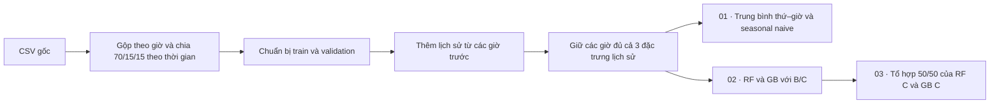

# Config C · Lịch sử lưu lượng và tổ hợp Random Forest + Gradient Boosting

Ba thí nghiệm ngày 17/11/2026 dùng cùng dữ liệu và giờ chấm. Config B dùng thời gian, ngày lễ và thời tiết. Config C giữ các cột của B và thêm lag_24h, lag_168h và mean_24h.

## Quy trình chung

Điền thiếu thời tiết bằng thống kê của train và chỉ tra các quan sát thời tiết đã có. Tra lag theo đúng timestamp. Trung bình 24 giờ loại giờ đang dự đoán và yêu cầu ít nhất 18 quan sát trong cửa sổ. Bài toán giả định thời tiết cùng giờ và lưu lượng quá khứ có sẵn khi dự đoán từng giờ. Trong validation tuần tự, giờ đã qua được phép cung cấp lưu lượng quan sát cho giờ sau.

Sau khi lọc, còn **22.503/28.402 giờ train** và **6.050/6.086 giờ validation**, trong đó **1.080 giờ cao điểm**. Các mô hình B/C được fit trên cùng tập train đủ lịch sử với tham số cố định theo từng mô hình. Các baseline và mô hình được chấm cùng timestamp và mục tiêu. Tập test dành cho đánh giá cuối.

## Kết quả validation

| Thí nghiệm | Phương án | MAE (xe/giờ) | RMSE (xe/giờ) | R² |
|---|---|---:|---:|---:|
| 01 | Trung bình thứ–giờ | 291,74 | 503,22 | 0,9344 |
| 01 | Cùng giờ tuần trước | 330,18 | 635,07 | 0,8955 |
| 02 | Random Forest B | 254,66 | 410,01 | 0,9564 |
| 02 | Random Forest C | **215,19** | 354,35 | 0,9675 |
| 02 | Gradient Boosting B | 277,03 | 422,35 | 0,9538 |
| 02 | Gradient Boosting C | 229,28 | 366,12 | 0,9653 |
| 03 | RF C + GB C (50/50) | 216,91 | **353,06** | 0,9677 |

- **01** Trung bình thứ–giờ thấp hơn seasonal naive **131,85 xe/giờ RMSE**. Hai mô hình C đều vượt cả hai baseline.
- **02** Thêm lịch sử giảm RMSE **55,65 xe/giờ (13,57%)** với Random Forest và **56,23 xe/giờ (13,31%)** với Gradient Boosting. Random Forest dùng 400 cây, độ sâu 12, lá tối thiểu 5 và max_features=1.0. Gradient Boosting dùng 200 cây, độ sâu 3 và learning_rate=0.1. Cả hai dùng seed 42.
- **03** Tổ hợp giảm RMSE chung **1,30 xe/giờ (0,37%)** so với RF C, nhưng MAE tăng **1,72 xe/giờ** và RMSE giờ cao điểm tăng từ **494,34** lên **504,09**. RF C là lựa chọn hiện tại nếu ưu tiên MAE hoặc giờ cao điểm. Nếu tiếp tục tối ưu RMSE chung bằng trọng số, học trọng số từ dự đoán ngoài fold trên train rồi mới chấm trên validation.

## Chạy lại

1. Mở dự án với kernel Python có các thư viện trong [requirements.txt](../../requirements.txt). Dữ liệu lấy từ data/Metro_Interstate_Traffic_Volume.csv hoặc bản nén trong files/.
2. Chạy **Run All** trong [01 · Baseline Config C](01_baselines/ConfigC_Baselines_Huy.ipynb). So trung bình thứ–giờ từ train với lưu lượng đúng giờ này của tuần trước.
3. Chạy **Run All** trong [02 · RF và GB, B/C](02_models_bc/RF_GB_BC.ipynb). Giữ nguyên tham số của từng mô hình khi chuyển từ B sang C. Notebook xuất dự đoán RF C và GB C theo timestamp.
4. Chạy **Run All** trong [03 · Tổ hợp 50/50](03_ensemble/ConfigC_Ensemble.ipynb) sau bước 3. Notebook đối chiếu lại giờ chấm và mục tiêu trước khi lấy trung bình hai dự đoán.
5. Đọc các bảng validation_metrics.csv trong outputs/ và biểu đồ trong figures/ của từng thí nghiệm. Khi cần kiểm tra một giờ cụ thể, dùng cột date_time trong validation_predictions.csv.

01 và 02 có thể chạy độc lập. 03 đọc CSV dự đoán của 02.
